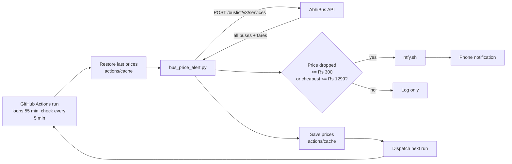

# Bus Ticket Price Alert

Get a phone notification when AbhiBus ticket prices drop, without keeping a laptop open.

Default route: **Bengaluru → Vijayawada**. Any AbhiBus route works.

---

## 1. Why this exists

Bus fares on AbhiBus change all the time. Watching the route on 16–17 Oct 2026 showed:

- Prices change every 2–10 minutes.
- Drops of Rs 300–1000 are common, and so are increases of the same size.
- The cheapest fares usually show up 1–2 hours before departure and last only 10–20 minutes.
- Very low fares (for example Rs 3120 → Rs 850) appear a few minutes before a bus leaves, when you can rarely still catch it.

Checking the website by hand misses most of this. This project checks automatically and sends a push notification.

---

## 2. End-to-end flow



GitHub's cron is unreliable for short intervals (it often skips `*/5` schedules), so each run stays alive for 55 minutes checking every 5 minutes, then starts the next run itself. An hourly cron (`7 0-18 * * *` UTC) only restarts the chain if it breaks, and in the morning, since the chain pauses 00:30–05:30 IST.

Each check:

1. The run starts (dispatched by the previous run, or by the backup cron).
2. The prices saved by the previous run are restored from the Actions cache.
3. The script calls the AbhiBus bus-list API for the route and date.
4. Buses that are full, or that leave within 45 minutes, are skipped.
5. Each bus's price is compared with the lowest price seen for it so far.
6. If it dropped by at least `MIN_DROP`, or the cheapest bus is at or below `ALERT_BELOW`, the script pushes to ntfy.sh.
7. The ntfy app on the phone shows the notification. Tapping it opens AbhiBus.
8. The updated prices are saved back to the cache for the next run.

---

## 3. The AbhiBus API

The AbhiBus website is a React single-page app. The search page HTML is an empty shell, and the bus list comes from a JSON API. The endpoint was found by reading the site's JavaScript bundle (`/static/index-*.js` and `BusSearchWrapper-*.js`).

**Request**

```http
POST https://www.abhibus.com/buslist/v3/services
Content-Type: application/json
X-APP-NAME: nextgenweb

{
  "source": "Bengaluru",
  "sourceid": 7,
  "destination": "Vijayawada",
  "destinationid": 5,
  "jdate": "2026-10-17",
  "prd": "mobile",
  "filters": "1",
  "isReturnJourney": "0",
  "version": "114"
}
```

No login or API key is needed.

**City IDs** are in the AbhiBus search URL:

```
https://www.abhibus.com/bus_search/Bengaluru/7/Vijayawada/5/16-10-2026/O
                                   name    id  name      id  date
```

**Useful response fields** (`services[]`, one per bus):

| Field | Meaning |
|---|---|
| `serviceId` | Unique, stable ID for the bus. Use this as the key, because `serviceName` and `serviceKey` repeat. |
| `fares.offerPrice` | Price after discount. Sometimes missing, so fall back to `fares.fare`. |
| `travelerAgentName` | Operator name |
| `busTypeName` | e.g. `VOLVO 9600 AC Multiaxle Sleeper (2 + 1)` |
| `timings.startTime` | Departure, e.g. `07:45 PM` |
| `timings.startTimeDateFormat` | Departure as ISO time with `+05:30` |
| `seatStats.availableSeats` | Seats left |

> This is the website's internal API, not a public, documented one. It can change without notice. Keep polling gentle (5 minutes or more).

---

## 4. Files

```
.
├── bus_price_alert.py                    # the watcher (Python standard library only)
├── .github/workflows/bus-price-alert.yml # GitHub Actions schedule
├── .gitignore                            # ignores local state
└── .bus_alert_state/                     # lowest prices seen (local runs only, git-ignored)
```

---

## 5. Phone setup (ntfy)

[ntfy](https://ntfy.sh) is a free push-notification service. There's no account, only a *topic* name.

1. Install the **ntfy** app (Play Store / App Store).
2. Tap **+** and subscribe to your topic (pick a hard-to-guess name such as `yourname-bus-x7k2p9`). Keep the server as `ntfy.sh`.
3. Allow notifications. On iPhone, also enable *Time Sensitive* for faster delivery.
4. Test it:

   ```bash
   curl -d "Phone alerts working" https://ntfy.sh/<your-topic>
   ```

> Topics on ntfy.sh are public. Anyone who knows the name can read them, so use a random name. Messages contain only bus prices.

---

## 6. GitHub Actions setup

1. Push this repo to GitHub. Make it **public** if you want unlimited free Actions minutes; a private repo's 2000 free minutes run out in about a week at 5-minute checks.
2. Add the ntfy topic as a secret:

   ```bash
   gh secret set NTFY_TOPIC --body "<your-topic>"
   ```

3. Optional: set repository variables (Settings → Secrets and variables → Actions → Variables):

   | Variable | Default | Meaning |
   |---|---|---|
   | `TRAVEL_DATE` | today (IST) | `DD-MM-YYYY` to watch a specific day |
   | `MIN_DROP` | `300` | Alert when a bus gets at least this much cheaper (Rs) |
   | `ALERT_BELOW` | `1299` | Alert when the cheapest bus is at or below this |
   | `MIN_LEAD` | `45` | Ignore buses leaving within this many minutes |
   | `DEPART_AFTER` | none | Only buses leaving at/after this time, `HH:MM` 24h (e.g. `17:00`) |
   | `DEPART_BEFORE` | none | Only buses leaving at/before this time, `HH:MM` 24h (e.g. `22:00`) |

   When `TRAVEL_DATE` is set and that date has passed, the workflow disables itself.

   ```bash
   gh variable set TRAVEL_DATE --body "20-10-2026"
   gh variable delete TRAVEL_DATE        # back to "today"
   gh variable set ALERT_BELOW --body "1500"
   ```

4. Test from GitHub: **Actions → Bus price alert → Run workflow → tick "Send a test alert"**, or:

   ```bash
   gh workflow run bus-price-alert.yml -f test=true
   ```

   The phone should get a "TEST alert" notification with the 5 cheapest buses.

**Pause and resume**

```bash
gh workflow disable bus-price-alert.yml
gh workflow enable bus-price-alert.yml
```

**How state is kept between runs:** every run restores the newest `bus-state-*` cache and saves a new one under `bus-state-<run_id>`. Old caches expire on their own after 7 days unused.

---

## 7. Running locally (optional)

The script also runs on a Mac, with desktop notifications through `osascript`.

```bash
# single check
python3 bus_price_alert.py --date today

# watch for 1 hour, every 2 min, big drops only, keep the Mac awake
caffeinate -i python3 bus_price_alert.py --date 17-10-2026 \
  --every 2 --for 60 --min-drop 300 --min-lead 45

# only AC sleepers under Rs 1500, with phone push
python3 bus_price_alert.py --date 20-10-2026 --bus-type "AC Sleeper" \
  --max-price 1500 --every 5 --ntfy <your-topic>
```

Don't run it locally while the GitHub workflow is on with the same topic, or you'll get every alert twice.

### All options

| Option | Meaning |
|---|---|
| `--src`, `--src-id`, `--dst`, `--dst-id` | Route (default Bengaluru 7 → Vijayawada 5) |
| `--date` | `DD-MM-YYYY` or `today` (IST). Required |
| `--operator` | Only buses whose operator name contains this, e.g. `intrcity` |
| `--bus-type` | Words that must appear in the bus type, e.g. `"AC Sleeper"`. `AC` does not match `NON-AC` |
| `--max-price` | Only send drop alerts for buses at or below this price |
| `--alert-below` | Extra alert when the cheapest bus is at or below this price |
| `--min-drop` | Ignore drops smaller than this (Rs). Default 1 |
| `--min-lead` | Ignore buses departing within N minutes |
| `--depart-after`, `--depart-before` | Only buses departing in this window, `HH:MM` 24h |
| `--every` | Repeat every N minutes. Without it, the script checks once |
| `--for` | Stop after N minutes |
| `--ntfy` | ntfy topic for phone push |
| `--test-alert` | Always send the 5 cheapest buses (to check alerts work) |
| `--state-dir` | Where the lowest-seen prices are stored |

---

## 8. Alert logic

For each bus (keyed by `serviceId`), the script saves:

```json
{ "low": 1549, "last": 1549, "operator": "Ira Transport" }
```

- **Drop alert:** current price < `low` − `min_drop`. Because it compares with the lowest price ever seen, a bus that goes up and comes back down doesn't alert again.
- **Under-limit alert:** the cheapest matching bus is at or below `alert_below`. This fires once per date.
- **First run:** saves the starting prices only, so nothing alerts.
- Up to 5 drops are sent per notification, cheapest first.

---

## 9. Troubleshooting

| Problem | Cause / fix |
|---|---|
| No alert even though the price looked lower | It wasn't below the *lowest seen* by at least `MIN_DROP`, the bus leaves within `MIN_LEAD`, or the bus has no seats |
| Local watcher stopped checking | The Mac went to sleep. Use `caffeinate -i`; closing the lid still sleeps the Mac |
| No Mac notification | System Settings → Notifications → Script Editor → allow |
| No runs at all | GitHub cron may not fire for hours on a new repo. Start the chain by hand: `gh workflow run bus-price-alert.yml` |
| Chain stopped | A run failed, so no next run was dispatched. Check the Actions tab, then start it again by hand |
| Workflow stopped after weeks | GitHub disables schedules after 60 days with no commits. Turn it back on in the Actions tab |
| `check failed: ...` in the log | The AbhiBus API changed or is down. Check the request in section 3 against the site's network tab |

---

## 10. Options considered

| Option | Verdict |
|---|---|
| Local Mac script | Fastest checks, but the laptop must stay open and awake |
| Claude cloud routine | Runs at most hourly, which is too slow for 10–20 minute price windows |
| **GitHub Actions + ntfy** | **Chosen.** Free on a public repo, checks every 5 min, laptop not needed |
| Android + Termux | Free, but Android only and the phone must stay on |
| Small VPS | Checks every 1–2 min, but the most setup and may cost money |
